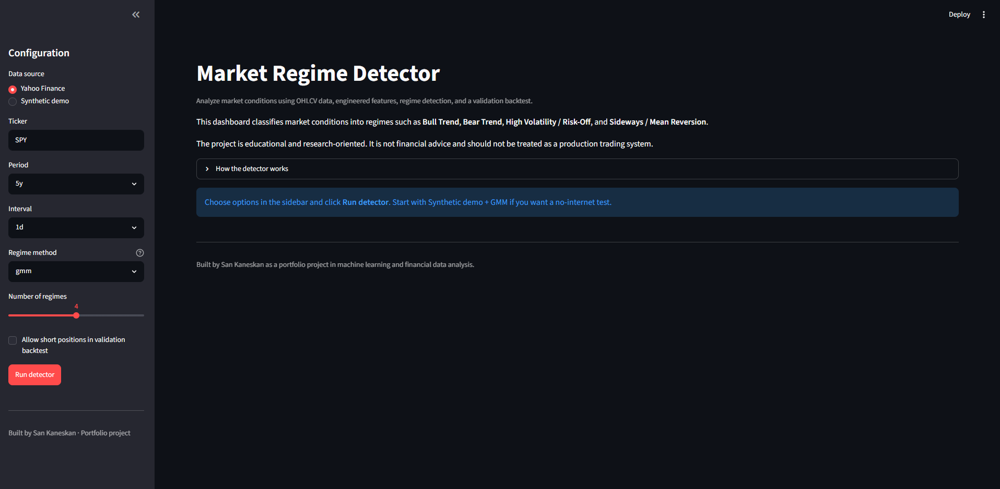
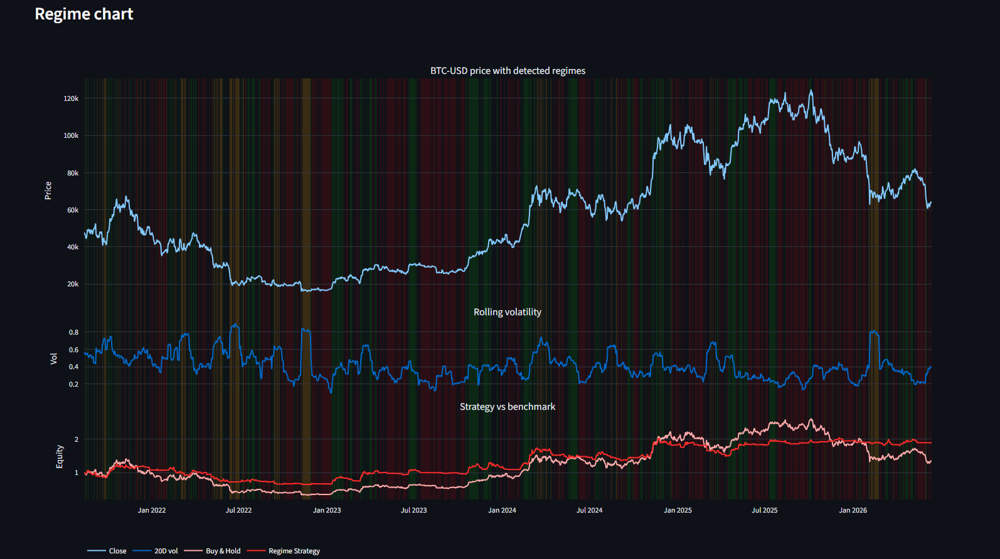
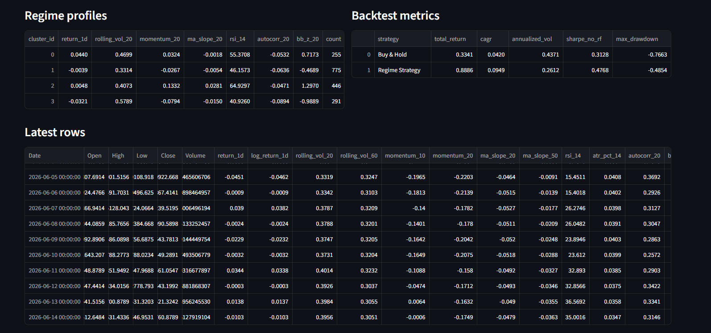

# Quant ML Lab

A Streamlit-based portfolio project for exploring applied machine learning in financial markets.

The project started as a **Market Regime Detector** and has now been expanded into a small Quant ML Lab with multiple research modules. The app currently includes:

- **Market Regime Detector**: classifies market conditions using engineered features and unsupervised learning.
- **Alpha Factor Discovery**: tests whether candidate signals have a historical relationship with future returns.

Built by **San Kaneskan** as a portfolio project exploring machine learning, applied mathematics, and financial time-series analysis.

---

## Live Demo

Try the deployed app here:

https://san-market.streamlit.app/

---

## Screenshots

### Dashboard



### Regime Chart



### Backtest Metrics



---

## Current Modules

### 1. Market Regime Detector

This module classifies the current market environment into regimes such as **bull trend**, **bear trend**, **high volatility**, and **sideways / mean-reverting conditions**.

Main question:

```text
What type of market environment are we currently in?
```

It uses OHLCV data, feature engineering, rule-based logic, KMeans, GMM, or HMM, and a simple validation backtest.

### 2. Alpha Factor Discovery

This module tests whether candidate factors such as momentum, RSI, volatility, Bollinger z-score, and volume z-score have a historical relationship with future returns.

Main question:

```text
Which signals may contain predictive information?
```

It ranks factors using IC, Rank IC, hit rate, quantile performance, scatter plots, and a simple factor-based validation strategy.

---

## Main Features

- Multipage Streamlit app with a Quant ML Lab homepage
- Load real market data from Yahoo Finance using `yfinance`
- Generate synthetic demo data for testing and offline use
- Create financial features from OHLCV data
- Detect market regimes using rule-based logic, KMeans, GMM, or HMM
- Test candidate alpha factors against future returns
- Visualize regimes and factor behavior with interactive Plotly charts
- Run the project from the dashboard or command line
- Run smoke tests with `pytest`

---

## Tech Stack

| Area | Tools |
|---|---|
| Language | Python |
| Data processing | NumPy, Pandas |
| Machine learning | scikit-learn, hmmlearn |
| Market data | yfinance |
| Visualization | Plotly |
| Dashboard | Streamlit |
| Testing | pytest |

---

## Project Structure

```text
market-regime-detector/
│
├── app/
│   ├── streamlit_app.py
│   └── pages/
│       ├── 1_Market_Regime_Detector.py
│       └── 2_Alpha_Factor_Discovery.py
│
├── market_regime_detector/
│   ├── __init__.py
│   ├── alpha_factors.py
│   ├── backtest.py
│   ├── cli.py
│   ├── data.py
│   ├── features.py
│   ├── regimes.py
│   └── visualization.py
│
├── tests/
│   ├── test_alpha_factors.py
│   └── test_smoke.py
│
├── images/
├── README.md
├── LEARNING_PATH.md
├── requirements.txt
├── pyproject.toml
└── .gitignore
```

---

## How It Works

The general workflow is:

```text
market data
    ↓
feature engineering
    ↓
model or statistical test
    ↓
visualization
    ↓
validation
```

### Data Loading

The app supports:

- **Yahoo Finance data** for real historical market data
- **Synthetic demo data** for testing and demonstration

Main file:

```text
market_regime_detector/data.py
```

### Feature Engineering

The raw market data contains OHLCV columns:

```text
Open, High, Low, Close, Volume
```

The project transforms these into financial features such as:

| Feature | Meaning |
|---|---|
| `return_1d` | One-period percentage price change |
| `log_return_1d` | Logarithmic price return |
| rolling volatility | Recent size of price movements |
| momentum | Recent trend direction |
| RSI | Overbought / oversold indicator |
| ATR | Average daily price range |
| Bollinger z-score | Distance from recent average price |
| volume z-score | Whether volume is unusually high or low |

Main file:

```text
market_regime_detector/features.py
```

### Market Regime Detection

The regime detector supports four methods:

| Method | Description | Best for |
|---|---|---|
| Rule-based | Uses transparent if/else thresholds | Learning and explainability |
| KMeans | Groups similar periods into hard clusters | Simple ML baseline |
| GMM | Uses probabilistic clustering | Recommended default |
| HMM | Models hidden states and transitions over time | Advanced sequence modelling |

Main file:

```text
market_regime_detector/regimes.py
```

### Alpha Factor Discovery

The alpha module creates a future-return target and tests candidate factors against it.

Examples:

```text
momentum_20 today → future_return_5d
RSI today         → future_return_5d
volatility today  → future_return_5d
```

Main file:

```text
market_regime_detector/alpha_factors.py
```

The future return is used only as the evaluation target, not as an input feature.

---

## Why I Chose This Approach

I chose this direction because it lets me build a growing financial ML research dashboard instead of a single isolated app.

The Market Regime Detector focuses on unsupervised learning:

```text
What type of market environment are we in?
```

The Alpha Factor Discovery module adds a supervised-learning style research question:

```text
Do any current features have a relationship with future returns?
```

Together, these modules help me practise financial feature engineering, model comparison, visualization, and validation while keeping the project explainable.

---

## Technical Decisions

### Plotly for visualization

I used Plotly because the dashboard is interactive. Users can zoom, hover, inspect individual points, and explore results visually.

### Synthetic data

Synthetic data is included so the project can still run for testing and demonstration even if Yahoo Finance data is unavailable.

### GMM as the default regime model

GMM is the recommended default because it is more flexible than KMeans but easier to explain than HMM. It handles overlapping regimes better than hard clustering.

### IC and Rank IC for alpha testing

The Alpha Factor Discovery page uses IC and Rank IC because they are simple, interpretable ways to measure whether a factor has a historical relationship with future returns.

---

## Limitations

This project is educational and should not be treated as a production trading system.

Current limitations:

- The backtests do not include trading fees, slippage, taxes, or realistic execution constraints.
- The validation is simple and does not include full walk-forward testing.
- More complex models, especially HMM, can overfit historical data.
- Alpha factors are tested historically and may not work in the future.
- Yahoo Finance data can sometimes contain missing values or adjusted price differences.
- The project currently uses only price and volume data.

---

## What I Learned

While building this project, I learned how to:

- Structure a Python data science project into reusable modules
- Build a multipage Streamlit application
- Work with OHLCV financial market data
- Create features such as returns, volatility, momentum, RSI, ATR, and Bollinger z-score
- Apply unsupervised learning to market regime detection
- Test candidate alpha factors against future returns
- Compare rule-based logic, KMeans, GMM, and HMM
- Build interactive dashboards with Streamlit and Plotly
- Use basic tests to check that the main pipeline works
- Think about validation issues such as look-ahead bias and overfitting

---

## Future Improvements

Future improvements I would like to add:

1. Walk-forward validation
2. Transaction costs and slippage in the backtests
3. Support for comparing multiple tickers
4. A dashboard page for comparing regime detection methods
5. More tests for missing data and failed downloads
6. More stable regime naming across different assets
7. Additional data sources such as macro indicators or volatility indexes
8. A volatility forecasting module
9. An options pricing module comparing neural networks with Black-Scholes

---

## Installation

Clone the repository:

```bash
git clone https://github.com/SanKTH3/market-regime-detector.git
cd market-regime-detector
```

Create a virtual environment:

```bash
python -m venv .venv
```

Activate it on Windows PowerShell:

```powershell
.\.venv\Scripts\Activate.ps1
```

Activate it on macOS or Linux:

```bash
source .venv/bin/activate
```

Install dependencies:

```bash
pip install -r requirements.txt
```

---

## Running the App Locally

Start the Streamlit dashboard:

```bash
streamlit run app/streamlit_app.py
```

Then open the local URL shown in the terminal.

---

## Command Line Usage

Run the Market Regime Detector with synthetic demo data:

```bash
python -m market_regime_detector.cli --synthetic --method gmm --out outputs/demo_gmm
```

Run with Yahoo Finance data:

```bash
python -m market_regime_detector.cli --ticker SPY --period 5y --method gmm --out outputs/spy_gmm
```

Available regime methods:

```text
rule
kmeans
gmm
hmm
```

The command-line version can generate local result files inside an `outputs/` folder. This folder is not included in the repository because it is generated automatically.

---

## Running Tests

Run the smoke tests with:

```bash
pytest
```

---

## Deployment

The app is deployed on Streamlit Community Cloud:

https://san-market.streamlit.app/

Streamlit installs the dependencies from `requirements.txt` during deployment.

---

## Disclaimer

This project is for educational and portfolio purposes only.

It is not financial advice, investment advice, or a production trading system. Historical backtest results do not guarantee future performance.
